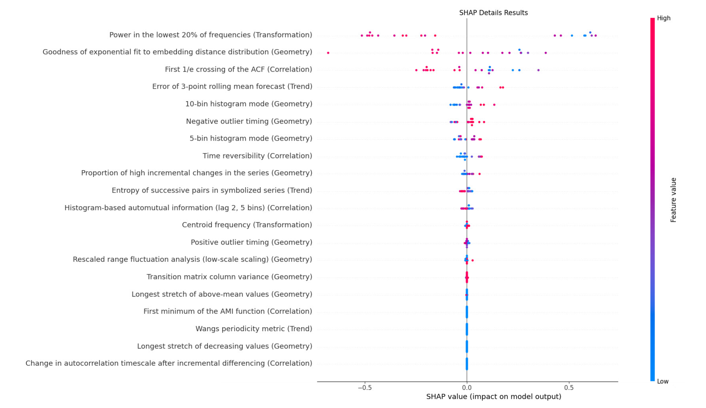

==============
Explainability
==============

The library provides insights into the algorithm's behavior by identifying the features that impact the imputation results. It trains a regression model to predict imputation results across various methods and uses SHapley Additive exPlanations (`SHAP <https://shap.readthedocs.io/en/latest/>`_) to reveal how different time series features influence the model’s predictions.

.. raw:: html

     

ExplainGAP module generates visualizations in the form of detailed reports and plots. In Figure 1, the SHAP values for each feature are plotted to illustrate their impact on the imputation results for a dataset.

   Fig 1. Features Visualization with SHAP-Based Explainer.

.. raw:: html

     

Each point on the plot represents the contribution of a specific input value with the color scale indicating the data value, ranging from low (blue) to high (red).
On the x-axis, input data with positive SHAP values increase the model’s output, while negative SHAP values decrease it.

.. raw:: html

    

.. _explaingaptuto:

ExplainGAP Tutorial
-------------------

Let's illustrate the explainer using the CDRec algorithm and MCAR missingness pattern:

.. code-block:: python

    from imputegap.recovery.manager import TimeSeries
    from imputegap.recovery.explainer import ExplainGAP

    # initialize the time series and explainer object
    ts = TimeSeries()
    exp = ExplainGAP()

    # load and normalize the dataset
    ts.load_series("eeg-alcohol")
    ts.normalize(normalizer="z_score")

    # configure the explanation
    exp.shap_explainer(input_data=ts.data, extractor="pycatch", pattern="mcar", file_name=ts.name, algorithm="CDRec")

    # print the impact of each feature
    exp.print(exp.shap_values, exp.shap_details)

All feature extractors developed in ImputeGAP are available in the ``ts.extractors`` module, which can be listed as follows:

.. code-block:: python

    from imputegap.recovery.manager import TimeSeries
    ts = TimeSeries()
    print(f"ImputeGAP features extractors : {ts.extractors}")

.. raw:: html

    
