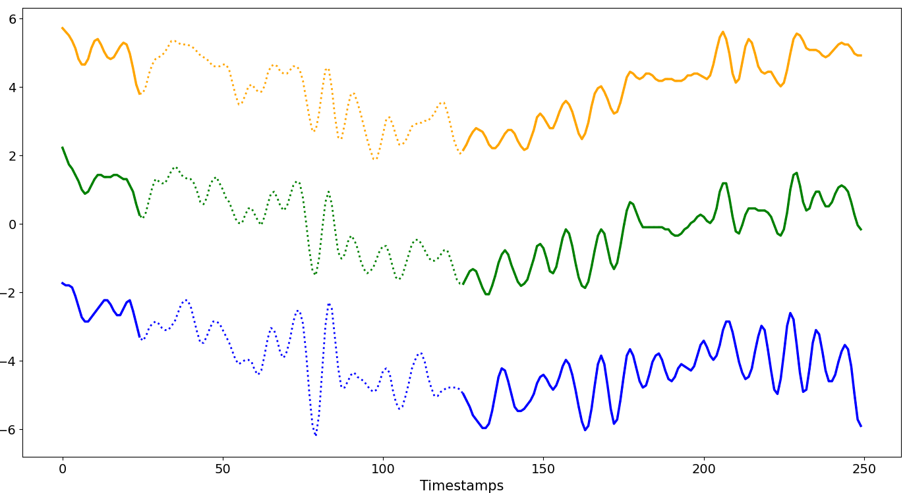
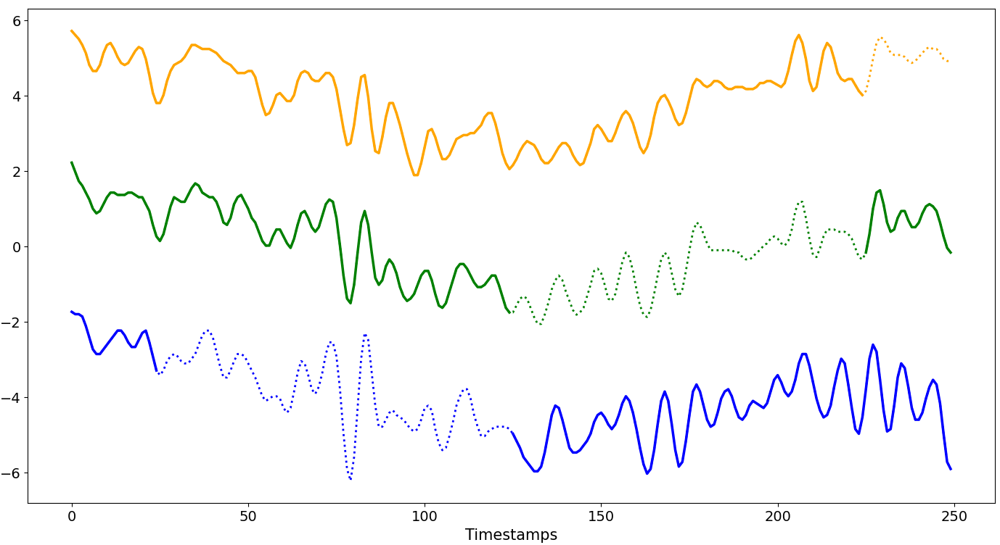
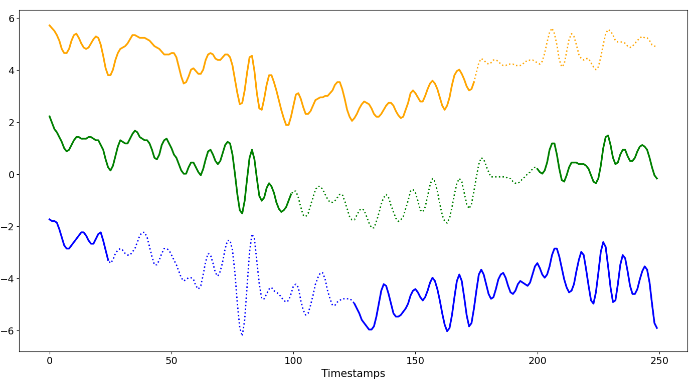
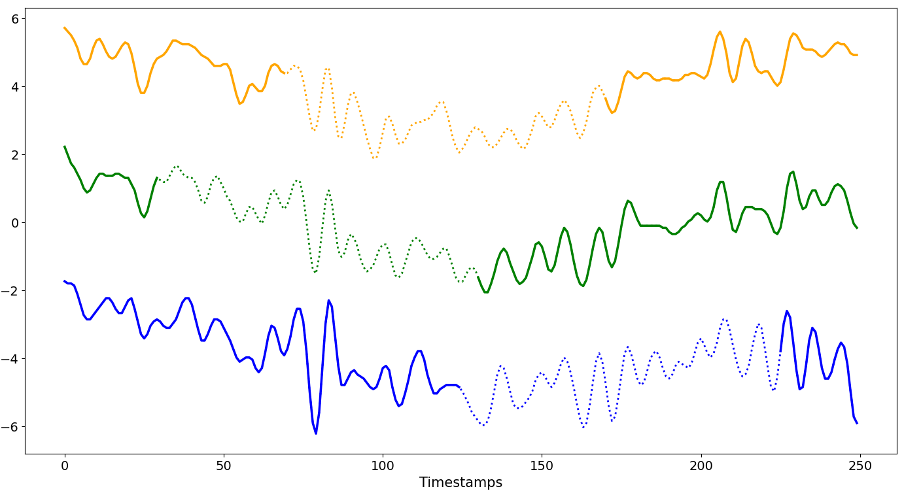
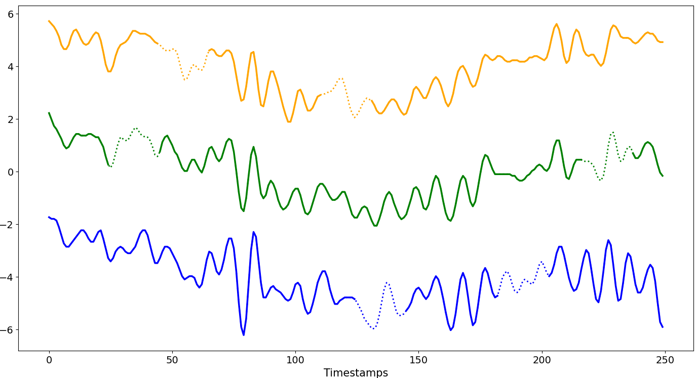
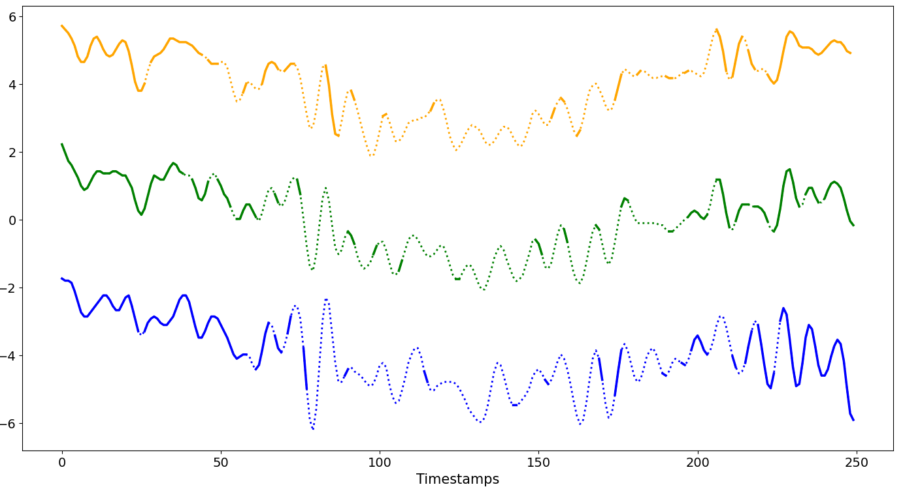

======
GenGAP
======

ImputeGAP introduces a new taxonomy of missingness patterns tailored to time series, going beyond the traditional MAR and MNAR categories, which were not designed for temporal data.

.. raw:: html

   

      <h2>Contents</h2>

      

         <a href="#setup">⚙️ Setup</a>
         <a href="#mono-block">▦ Mono-Block</a>
         <a href="#multi-block">▦ Multi-Block</a>
         <a href="#contaminationtuto">📖 GenGAP Tutorial</a>
      

   

.. _setup:

Setup
-----

.. note::

    -   (N, M) : number of timestamps, number of series
    -   W : user-defined offset window in the beginning of the series (default = 25)
    -   R : user-defined % of missing values (default = 20%)
    -   S : user-defined % of contaminated series (default = 20%)

.. _scenariomonoblock:

MONO-BLOCK
----------
One missing block per series

**Aligned**

Missing blocks start at the same selected positions and have the same fixed size across the chosen series, resulting in aligned missing intervals.

.. note::

    -   ``R ∈ [1%, (100-W)%]``
    -   The size of a single missing block varies between 1% and (100 - ``W``)% of ``N``.
    -   The starting position is the same and begins at ``W`` and progresses until the size of the missing block is reached, affecting the first series from the top up to ``S%`` of the dataset.
    -   ``GenGAP.aligned(ts.data, rate_dataset=1, rate_series=0.4, offset=25)``

.. raw:: html

    

**Disjoint**

Each missing block begins where the previous one ends, so the missing intervals are consecutive and do not overlap.

.. note::

    -   ``R ∈ [1%, (100-W)%]``
    -   The size of a single missing block varies between 1% and (100 - ``W``)% of ``N``.
    -   The starting position of the first missing block begins at ``W``.
    -   ``GenGAP.disjoint(ts.data, rate_series=0.4, offset=25)``

.. raw:: html

    

**Overlap**

Each missing block overlaps with the previous one.

.. note::

    -   ``R ∈ [1%, (100-W)%]``
    -   The size of a single missing block varies between 1% and (100 - ``W``)% of ``N``.
    -   The starting position of the first missing block begins at ``W``.
    -   The overlap is controlled by the variable ``shift``.
    -   This pattern continues until the limit or ``N`` is reached.
    -   ``GenGAP.overlap(ts.data, rate_series=0.4, offset=25, shift=0.1)``

.. raw:: html

    

**Scattered**

The starting position of the missing block is chosen at random, all missing blocks share the same size.

.. note::

    -   ``R ∈ [1%, (100-W)%]``
    -   The size of a single missing block varies between 1% and (100 - ``W``)% of ``N``.
    -   The starting position is random, then progresses until the size of the missing block is reached, affecting the first series from the top up to ``S%`` of the dataset.
    -   ``GenGAP.scattered(ts.data, rate_dataset=1, rate_series=0.4, offset=25)``

.. raw:: html

    

.. _scenariomultiblock:

MULTI-BLOCK
-----------

Multiple missing blocks per series

**MCAR**

Missing blocks have the same size and are introduced completely at random. The affected time series are selected at random.

.. note::

    -   ``R ∈ [1%, (100-W)%]``
    -   Data blocks of the same size are removed from arbitrary series at a random position between ``W`` and ``N``, until the total number of missing values per series is reached.
    -   ``GenGAP.mcar(ts.data, rate_dataset=1, rate_series=0.2, offset=25, seed=False, block_size=20)``

.. raw:: html

    

**Block Distribution**

Missing data follows a probability distribution, each position has a certain chance of being missing.

.. note::

    -   ``R ∈ [1%, (100-W)%]``
    -   Data is removed following a distribution given by the user for every values of the series, affecting the first series from the top up to ``S%`` of the dataset.
    -   ``GenGAP.gaussian(ts.data, rate_dataset=1, rate_series=0.4, offset=25, selected_mean="position", std_dev=0.2)``

To configure the block distribution pattern, please refer to this `page <tutorials_distribution.html>`_.

.. _contaminationtuto:

GenGAP Tutorial
---------------

ImputeGAP implements a module to simulate different missingness patterns in time series. The GenGAP module can be invoked externally.

As example, we show how to contaminate the eeg-alcohol dataset with the MCAR pattern:

.. code-block:: python

    from imputegap.recovery.manager import TimeSeries
    from imputegap.recovery.contamination import GenGAP
    from imputegap.tools import utils

    # initialize the time series object
    ts = TimeSeries()

    # load and normalize the dataset
    ts.load_series(utils.search_path("eeg-alcohol"), normalizer="z_score")

    # contaminate the time series with MCAR pattern
    ts_m = GenGAP.mcar(ts.data, rate_dataset=0.2, rate_series=0.4, block_size=10, seed=True)

    # plot the contaminated time series
    ts.plot(ts.data, ts_m, nbr_series=9, subplot=True, save_path="./imputegap_assets/contamination")

All missingness patterns developed in ImputeGAP are available in the ``ts.patterns`` module. They can be listed as follows:

.. code-block:: python

    from imputegap.recovery.manager import TimeSeries
    ts = TimeSeries()
    print(f"Missingness patterns : {ts.patterns}")

